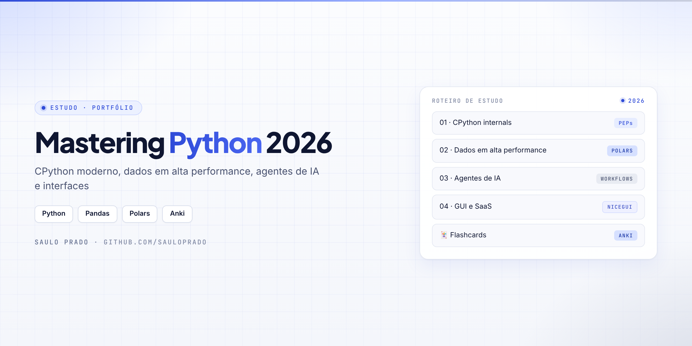
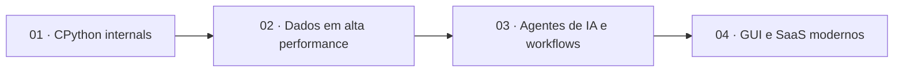

<p align="center">

</p>

<h1 align="center">Mastering Python 2026</h1>
<p align="center"><i>Estudo e portfólio técnico: CPython moderno, dados em alta performance, agentes de IA e interfaces</i></p>

<p align="center">


</p>

## Sumário

- [Sobre](#sobre)
- [Roteiro](#roteiro)
- [Flashcards](#flashcards)
- [Referências](#referências)
- [Estrutura do repositório](#estrutura-do-repositório)
- [Autor](#autor)

## Sobre

Roteiro de estudos para dominar o **Python de 2026**: o que mudou no interpretador, como trabalhar com dados em alta performance, como construir agentes de IA e como entregar interfaces modernas. Cada módulo evolui de forma incremental, com anotações, notebooks e código.

## Roteiro



| Módulo | Foco | Status |
| --- | --- | --- |
| [`01-cpython-internals/`](01-cpython-internals/) | PEPs recentes, free-threading, múltiplos interpretadores, t-strings | 🔜 planejado |
| [`02-high-performance-data/`](02-high-performance-data/) | Pandas 3.x, Polars (lazy) e RAPIDS cuDF — [roteiro](02-high-performance-data/README.md) | 🔄 em andamento |
| [`03-ai-agents-and-workflows/`](03-ai-agents-and-workflows/) | Agentes, ingestão de documentos e workflows resilientes | 🔜 planejado |
| [`04-modern-gui-saas/`](04-modern-gui-saas/) | NiceGUI, Streamlit, PySide6 / QML | 🔜 planejado |

## Flashcards

Cartões para memorização em Markdown e prontos para importar no **Anki**:

| Tema | Leitura | Importação no Anki |
| --- | --- | --- |
| Python especialista 2026 | [python-especialista-2026.md](flashcards/python-especialista-2026.md) | `flashcards/anki-import.tsv` |
| Pandas, Polars e cuDF | [pandas-polars-cudf.md](flashcards/pandas-polars-cudf.md) | `flashcards/anki-pandas-polars.tsv` |

> No Anki: importar o `.tsv` com separador **tabulação** e tipo de nota **Básico** (frente / verso).

## Referências

- [PEP 703](https://peps.python.org/pep-0703/) — GIL opcional / free-threading
- [PEP 779](https://peps.python.org/pep-0779/) — critérios de suporte ao build free-threaded
- [PEP 734](https://peps.python.org/pep-0734/) — múltiplos interpretadores (`concurrent.interpreters`)
- [PEP 750](https://peps.python.org/pep-0750/) — template strings (`t"..."`)

## Estrutura do repositório

```text
Mastering-Python-2026/
├── 01-cpython-internals/
├── 02-high-performance-data/
│   └── README.md
├── 03-ai-agents-and-workflows/
├── 04-modern-gui-saas/
├── flashcards/
│   ├── python-especialista-2026.md
│   ├── pandas-polars-cudf.md
│   ├── anki-import.tsv
│   └── anki-pandas-polars.tsv
└── assets/capa.png
```

## Autor

**Saulo Prado** · Analista de Sistemas · Gestão de Ativos de TI, orçamento, automação e dashboards

[](https://www.linkedin.com/in/saulo-prado-ab4a0b96/)
[](https://github.com/sauloprado)
